# SIS401 Programming Assignment 2 - IoT Data Pipeline

**Cloud Ingestion, Real-Time Dashboard and Remote Actuation**

| | |
|---|---|
| **Module** | SIS401 - Smart Integrated Systems (Tutor: Darshan Subedi) |
| **Group** | Group 3 |
| **Repository** | ______________________ |
| **Date** | 27 October 2026 |
| **Sensors** | DHT22 (temperature + humidity), LDR light-sensor module (analog) |
| **Broker** | Mosquitto 2.0.21 on Raspberry Pi 4 |
| **Cloud platform** | ThingsBoard Cloud |
| **Dashboard** | Node-RED 5.0.9 with Node-RED Dashboard 2.0 |
| **Actuators** | SG90 servo motor (remote control), red LED (local over-temperature alert) |

---

## 1. Requirement summary

| Requirement | Status | Evidence |
|---|---|---|
| FR1 - Two sensors publishing over MQTT with a topic hierarchy | Done | [Section 5](#5-fr1--sensor-data-collection-and-mqtt-publishing) |
| FR2 - Cloud platform receiving telemetry, alarm configured | Done | [Section 7](#7-fr2--cloud-platform-integration-thingsboard-cloud) |
| FR3 - Real-time dashboard with at least two streams and a chart | Done | [Section 8](#8-fr3--real-time-dashboard) |
| FR4 - Remote actuation with state acknowledgement | Done | [Section 9](#9-fr4--remote-actuation) |
| Extension - Edge AI | Not attempted | — |

---

## 2. System architecture

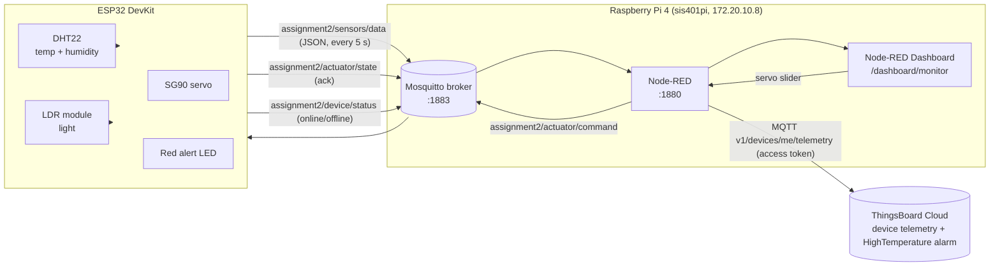

**Data path.** The ESP32 reads both sensors and publishes one JSON message every 5 seconds to the Mosquitto broker on the Raspberry Pi. Node-RED on the Pi subscribes to the broker. It reshapes the data and forwards it to ThingsBoard Cloud over MQTT, and it also feeds the live dashboard.

**Control path.** Moving the servo slider on the dashboard makes Node-RED publish an angle to the command topic. The ESP32 receives it, moves the servo, and publishes the new state back on the acknowledgement topic. The dashboard then shows that confirmed state.

All devices share one network, a mobile hotspot (172.20.10.0/28), so that lab WiFi restrictions on port 1883 and outbound traffic do not block the system.

---

## 3. Hardware

### 3.1 Components

| Component | Purpose |
|---|---|
| ESP32 DevKit (USB-C) | Main microcontroller, WiFi, MQTT client |
| DHT22 module | Temperature (°C) and relative humidity (%) |
| LDR light-sensor module (analog output) | Ambient light, read on an ADC pin |
| SG90 micro servo | Remotely controlled actuator (0–180°) |
| Red LED + current-limiting resistor | Local over-temperature indicator |
| Electrolytic capacitor | Smooths the servo supply rail against current spikes |
| Raspberry Pi 4 | MQTT broker and Node-RED host |

### 3.2 Pin mapping

| Device | ESP32 pin |
|---|---|
| DHT22 data | GPIO `__` |
| LDR analog out (AO) | GPIO `__` (ADC1 pin) |
| Servo signal | GPIO `__` |
| Alert LED | GPIO `__` |

> Fill in the pin numbers to match `#define` lines in the sketch. ADC1 pins (GPIO 32–39) are used for the LDR because ADC2 pins do not work while WiFi is active.

### 3.3 Hardware photos

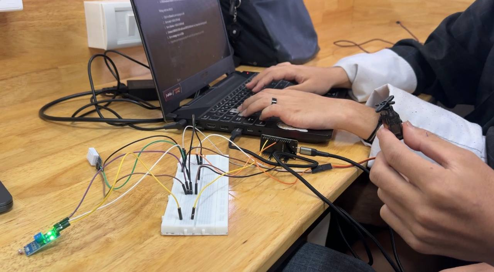

*Figure 1. Breadboard wiring with the DHT22, LDR module and ESP32.*

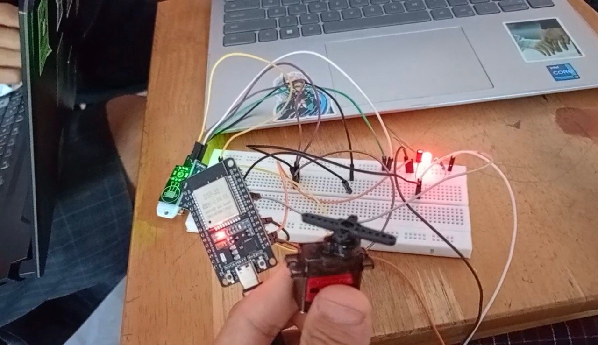

*Figure 2. ESP32 with SG90 servo and red alert LED lit.*

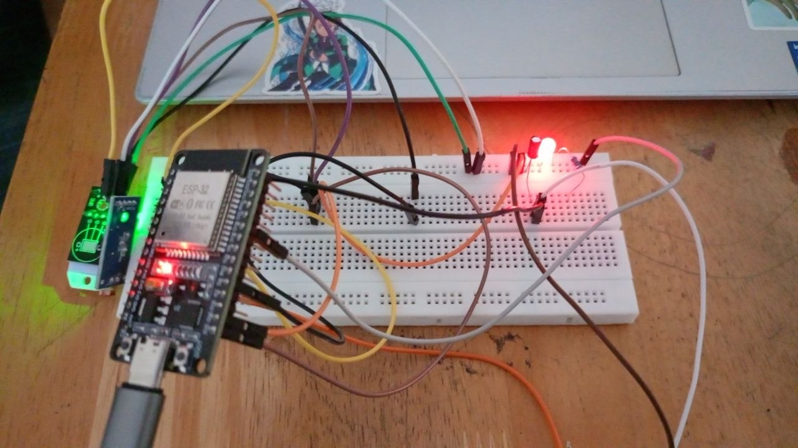

*Figure 3. Close-up of the final wiring.*

### 3.4 Hardware test

Before adding networking, a standalone test sketch checked every component. It swept the servo between 0° and 180°, toggled the LED, and printed sensor readings every 2.5 seconds.

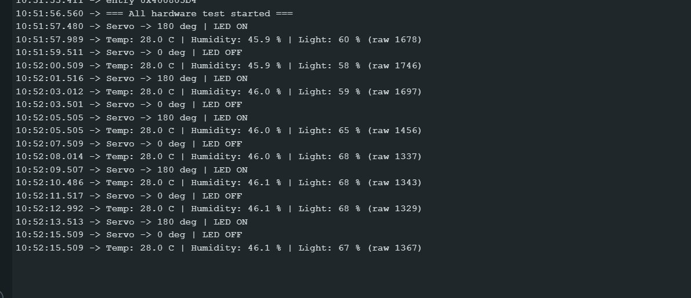

*Figure 4. Hardware test output: servo and LED respond, DHT22 reads about 28 °C and 46 % RH, and light is 58–68 %.*

The light percentage is inverted from the raw ADC value, because the module's output voltage rises as the room gets darker:

```
light_% = 100 − (raw × 100 / 4095)
```

For example, raw 1678 gives 59 %, and raw 1337 gives 67 %.

---

## 4. Raspberry Pi and MQTT broker setup

### 4.1 Flashing the operating system

Raspberry Pi OS Lite (64-bit) was written with Raspberry Pi Imager. The imager also set the hostname (`sis401pi`), the user account (`group3`), the hotspot WiFi credentials and SSH, so the Pi could run headless from first boot.

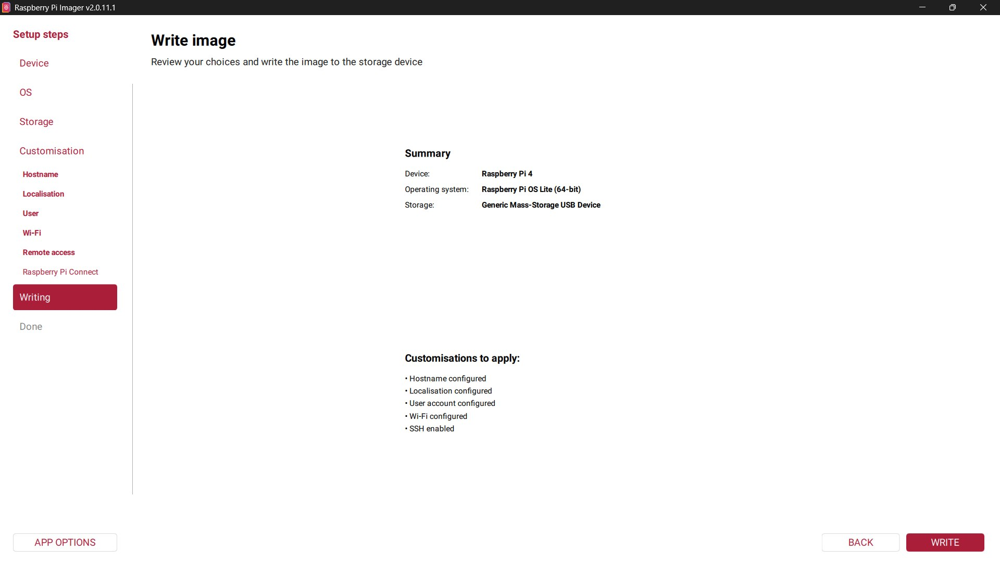

*Figure 5. Imager settings: Raspberry Pi 4, Pi OS Lite 64-bit, customisations applied.*

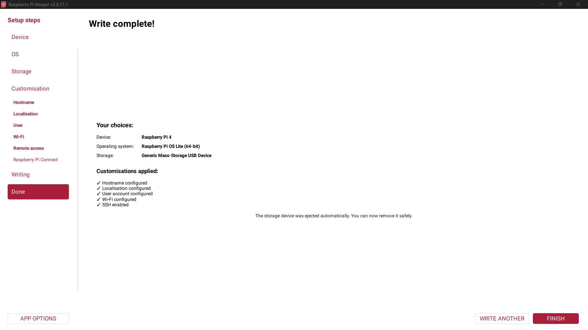

*Figure 6. Image written successfully.*

### 4.2 Finding the Pi on the network

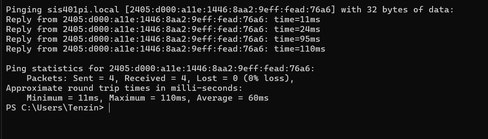

*Figure 7. `ping sis401pi.local` resolves to an IPv6 address by default.*

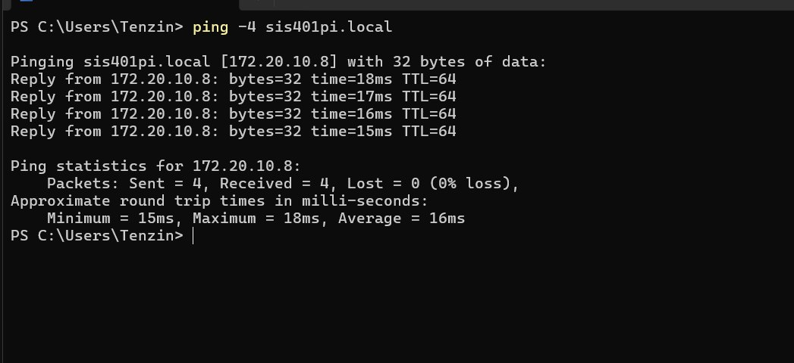

*Figure 8. `ping -4 sis401pi.local` gives the IPv4 address `172.20.10.8`, which the ESP32 uses as `MQTT_BROKER`.*

The ESP32 needs an IPv4 address, which is why `-4` was used.

### 4.3 Installing Mosquitto

```bash
sudo apt update
sudo apt install -y mosquitto mosquitto-clients
sudo systemctl enable mosquitto
sudo systemctl status mosquitto --no-pager
```

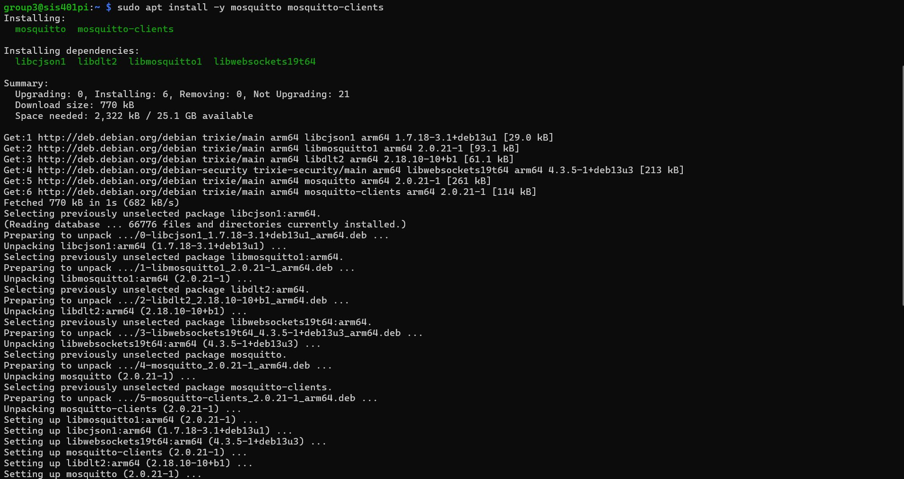

*Figure 9. Mosquitto 2.0.21 installed from the Debian (trixie) repository.*

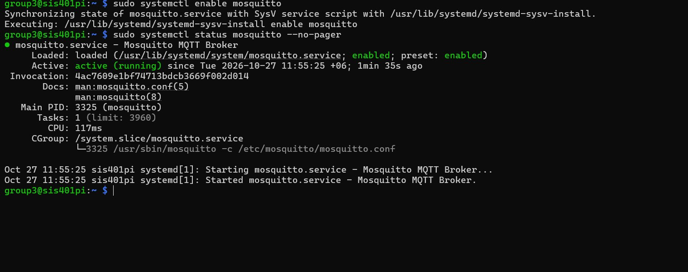

*Figure 10. The broker is enabled at boot and running.*

### 4.4 Allowing network clients

Mosquitto 2.x accepts only local connections by default. A small config file opens port 1883 to the local network:

```bash
sudo tee /etc/mosquitto/conf.d/assignment2.conf > /dev/null <<'EOF'
# SIS401 Assignment 2 - allow ESP32 and Node-RED on the local network
listener 1883 0.0.0.0
allow_anonymous true
EOF
sudo systemctl restart mosquitto
sudo ss -tlnp | grep 1883
```

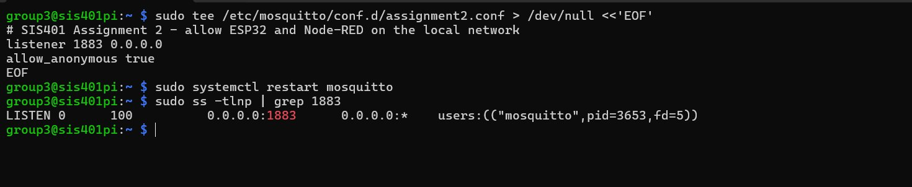

*Figure 11. Mosquitto listening on `0.0.0.0:1883`.*

> Anonymous access is acceptable here only because the broker sits on a private hotspot. In a real deployment, use a password file (`mosquitto_passwd`) and TLS on port 8883.

### 4.5 Broker test

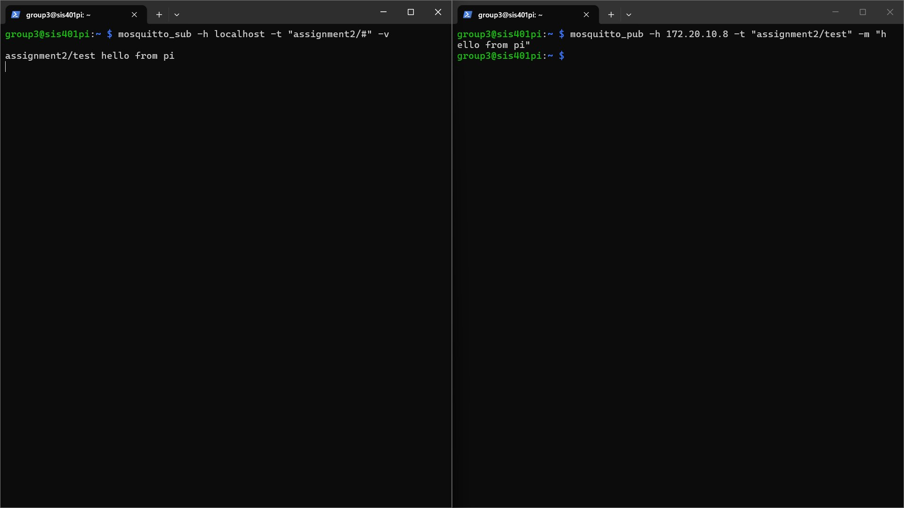

*Figure 12. A subscriber on `assignment2/#` receives a message published to the Pi's network address.*

---

## 5. FR1 - Sensor data collection and MQTT publishing

### 5.1 Topic hierarchy

| Topic | Direction | Payload | Purpose |
|---|---|---|---|
| `assignment2/sensors/data` | ESP32 → broker | JSON (below) | Sensor telemetry every 5 s |
| `assignment2/actuator/command` | Dashboard → ESP32 | Angle `0`–`180` | Servo command |
| `assignment2/actuator/state` | ESP32 → broker | JSON | Actuator acknowledgement |
| `assignment2/device/status` | ESP32 → broker | `online` / `offline` | Device presence (Last Will) |

### 5.2 Telemetry payload

```json
{
  "temperature": 27.4,
  "humidity": 39.7,
  "light": 53,
  "light_raw": 1934,
  "dht_ok": true,
  "rssi": -58,
  "uptime_s": 55,
  "alert": false
}
```

| Field | Meaning |
|---|---|
| `temperature`, `humidity` | DHT22 readings |
| `light`, `light_raw` | Light percentage and the raw 12-bit ADC value, kept for calibration |
| `dht_ok` | `false` if the DHT22 read failed, so a bad read is reported instead of sent as fake data |
| `rssi` | WiFi signal strength, for diagnosing connection problems |
| `uptime_s` | Seconds since boot, which makes a device reset visible |
| `alert` | `true` when temperature is above 30 °C; also switches on the red LED |

### 5.3 Evidence

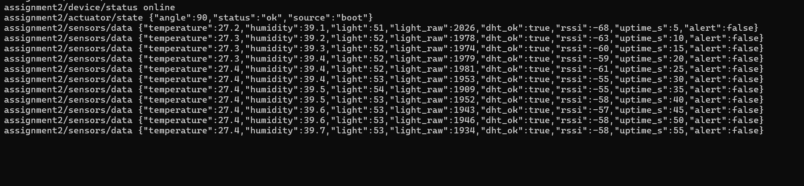

*Figure 13. `mosquitto_sub` on the Pi. It shows the `online` status, the boot acknowledgement from the servo, and telemetry every 5 s (`uptime_s` 5, 10, 15 …).*

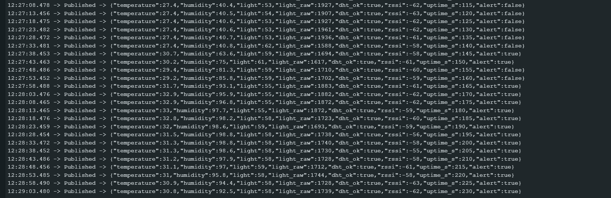

*Figure 14. ESP32 serial log of each published payload. Breathing on the DHT22 raised humidity from 40 % to 98 % and temperature past 30 °C.*

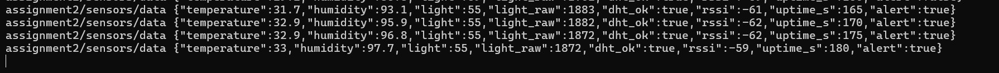

*Figure 15. Once temperature passes 30 °C, `alert` becomes `true` and the red LED turns on.*

In Figure 14, `alert` goes back to `false` at 29.4 °C even though humidity is 81 %. This confirms that the alert depends only on temperature.

---

## 6. Node-RED setup

Node-RED was installed with the official Raspberry Pi script and run as a service so that it starts on boot:

```bash
bash <(curl -sL https://github.com/node-red/linux-installers/releases/latest/download/update-nodejs-and-nodered-deb)
sudo systemctl enable nodered.service
sudo systemctl start nodered.service
```

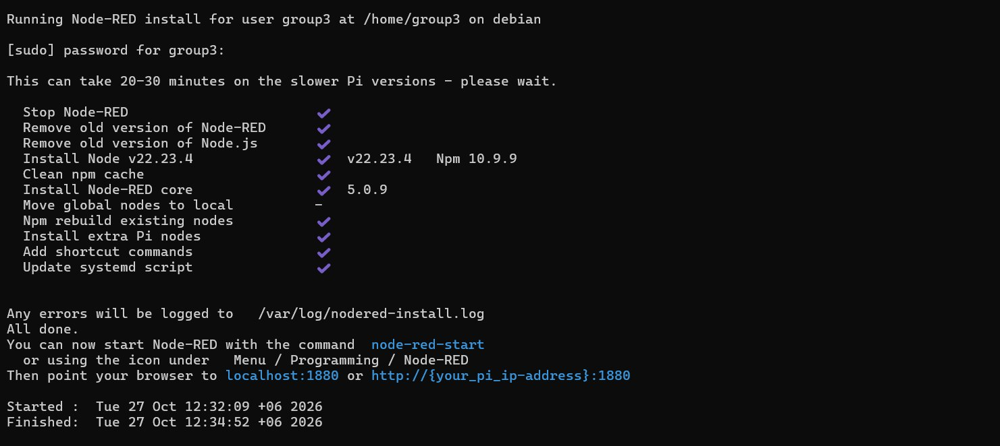

*Figure 16. Node-RED 5.0.9 with Node.js v22 installed.*

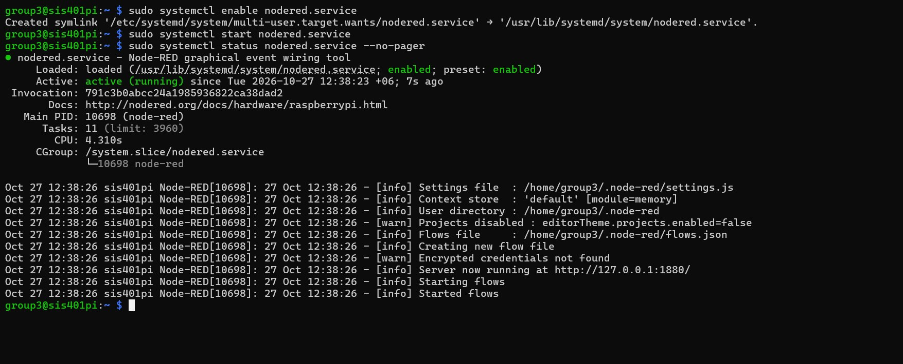

*Figure 17. The `nodered` service is enabled and running.*

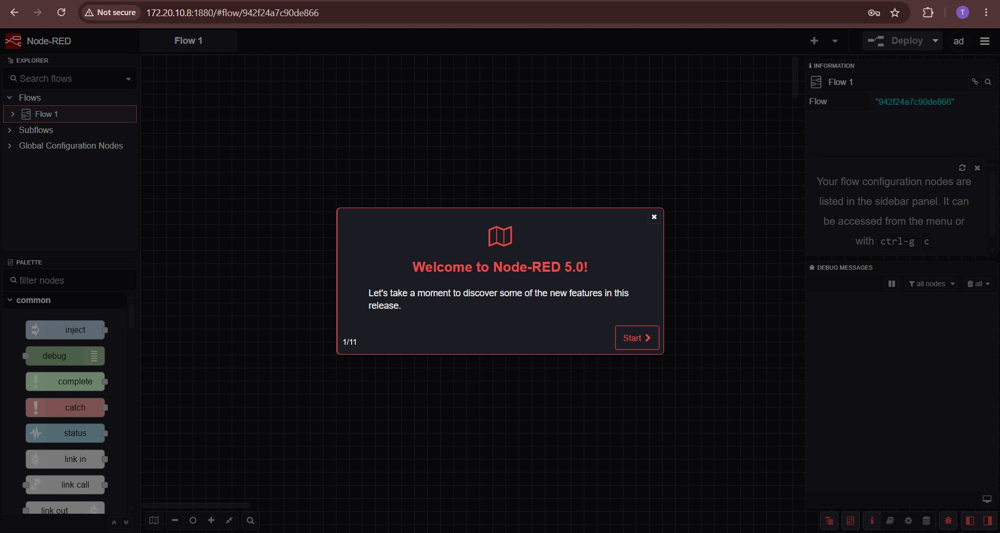

*Figure 18. Editor reached at `http://172.20.10.8:1880`.*

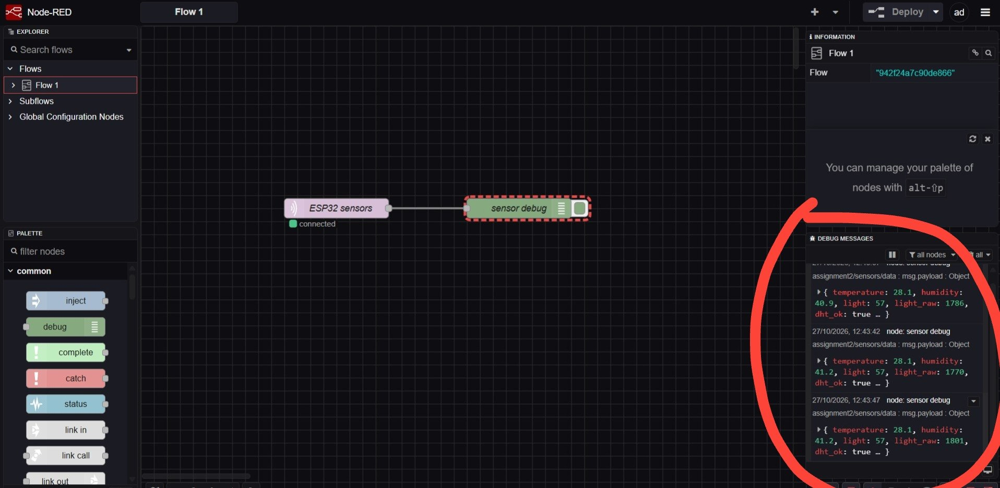

*Figure 19. The MQTT-in node "ESP32 sensors" is connected. The debug panel shows each payload parsed as a JSON object.*

---

## 7. FR2 - Cloud platform integration (ThingsBoard Cloud)

### 7.1 Device registration

A device named **`SIS401_A2_Group3_ESP32`** was created on ThingsBoard Cloud, and its **access token** is used as the credential. The token was first checked with a single HTTP request from the Pi:

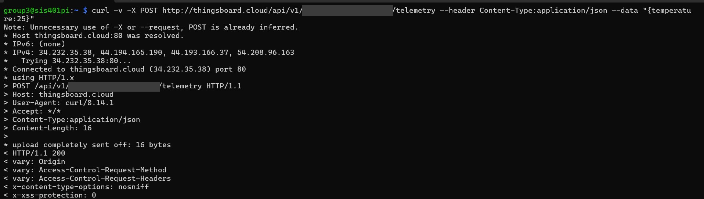

*Figure 20. A test POST to the device telemetry API returns `HTTP 200`. The access token is hidden in this screenshot.*

### 7.2 Forwarding flow

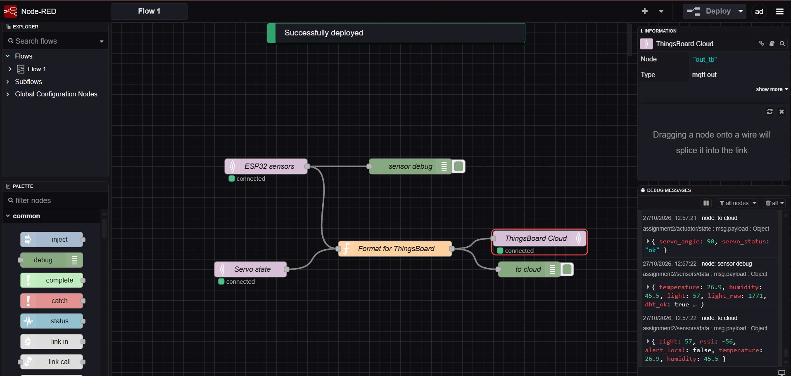

*Figure 21. Node-RED flow: sensor and servo-state messages pass through "Format for ThingsBoard" and on to the "ThingsBoard Cloud" MQTT-out node, which is connected.*

The function node keeps only the fields the cloud needs and renames a few so they are clear on the cloud side:

| From topic | Sent to ThingsBoard |
|---|---|
| `assignment2/sensors/data` | `temperature`, `humidity`, `light`, `rssi`, `alert_local` |
| `assignment2/actuator/state` | `servo_angle`, `servo_status` |

The MQTT-out node connects to `mqtt.thingsboard.cloud:1883`. It uses the device access token as the username and publishes to `v1/devices/me/telemetry`. The ESP32 talks only to the local broker, which has three benefits:

- The cloud credentials stay on the Pi rather than on the ESP32.
- The ESP32 code stays simple.
- Local monitoring keeps working even if the internet connection drops.

### 7.3 Telemetry in the cloud

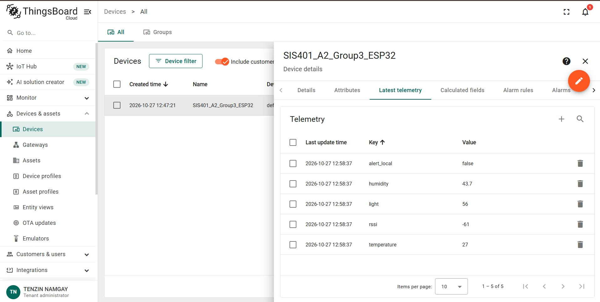

*Figure 22. Latest telemetry on ThingsBoard Cloud: `alert_local`, `humidity`, `light`, `rssi` and `temperature`, all updated at the same timestamp.*

### 7.4 Cloud alarm rule

| Setting | Value |
|---|---|
| Alarm type | `HighTemperature` |
| Severity | Critical |
| Condition | `temperature` greater than 30 |
| Schedule | Active all the time |

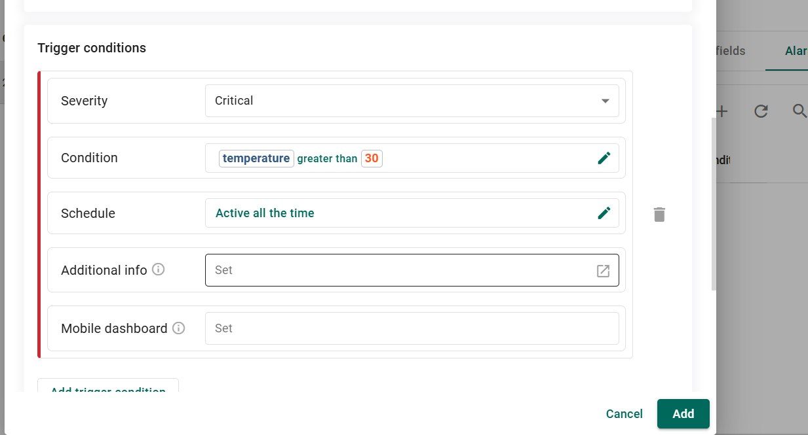

*Figure 23. Trigger condition for the alarm rule.*

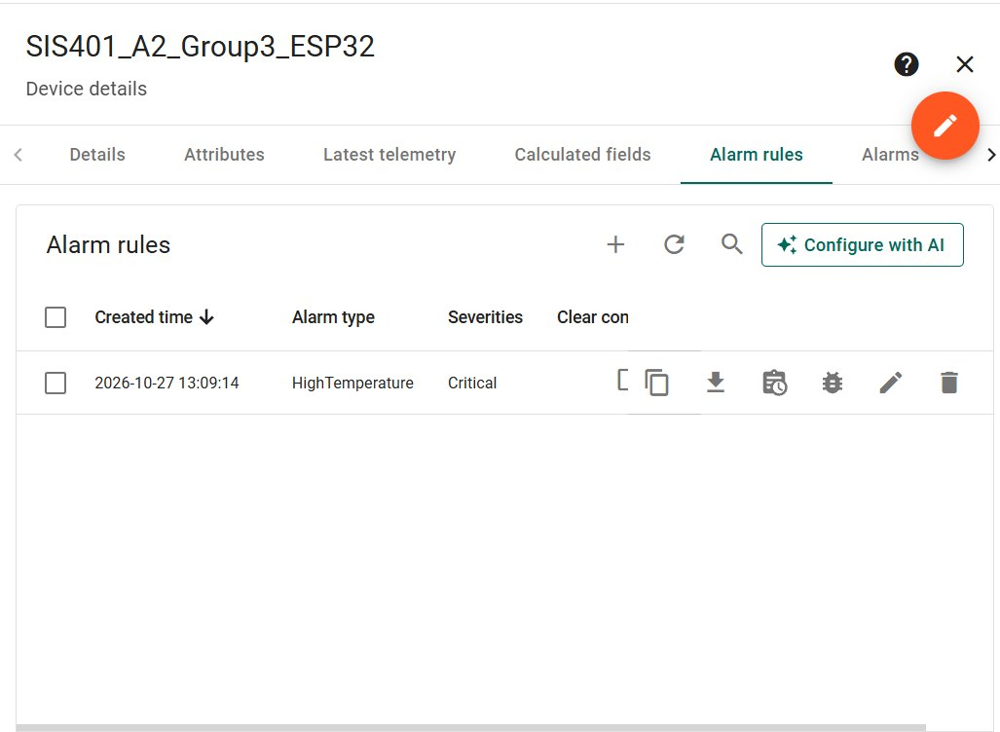

*Figure 24. The `HighTemperature` alarm rule on the device.*

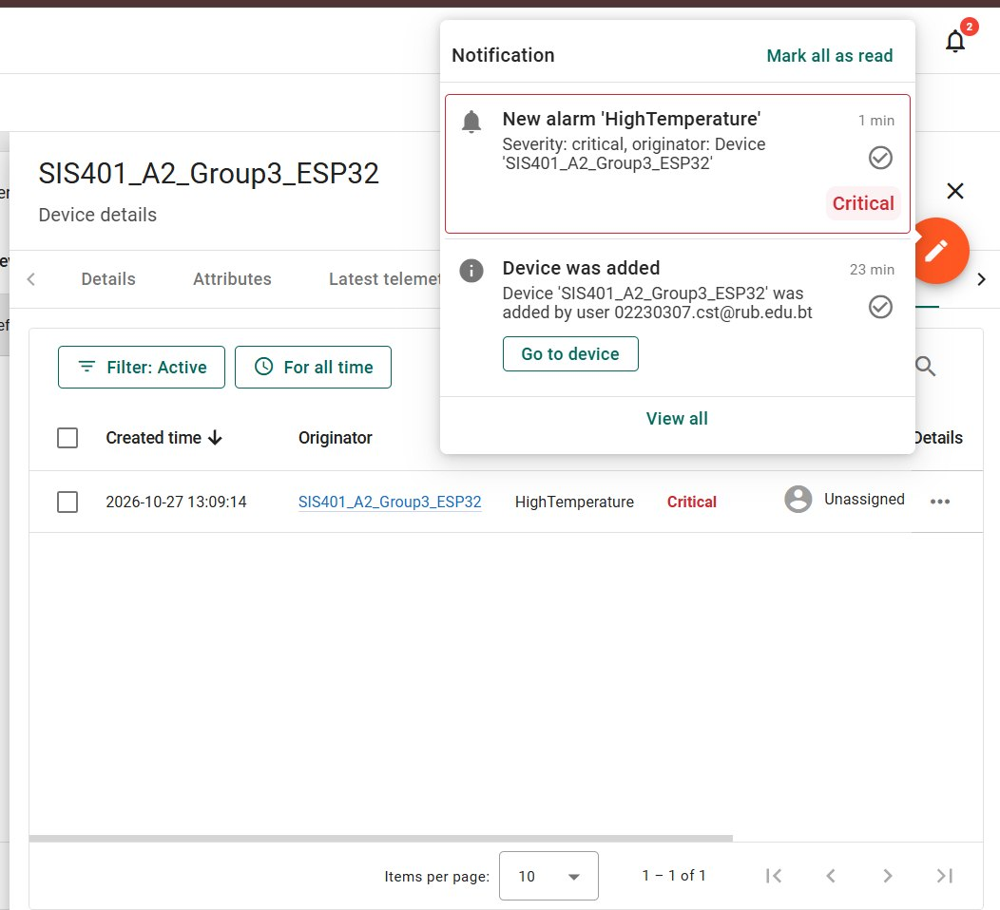

*Figure 25. Warming the sensor above 30 °C raised an active Critical alarm, and ThingsBoard sent a notification.*

The 30 °C threshold matches the ESP32's own alert. The device reacts immediately with the LED, and the cloud keeps an alarm record that can be acknowledged and reviewed later.

---

## 8. FR3 - Real-time dashboard

The dashboard is built with Node-RED Dashboard 2.0 and served at `http://172.20.10.8:1880/dashboard/monitor`.

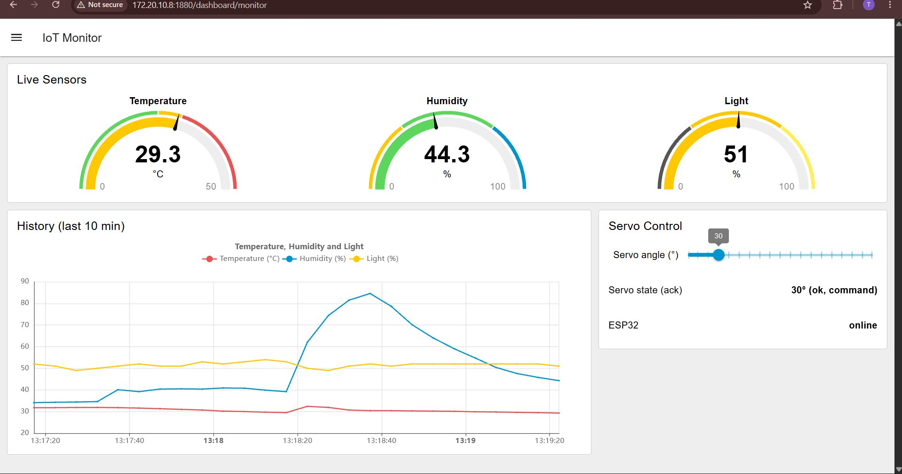

*Figure 26. The "IoT Monitor" dashboard.*

| Widget | Shows |
|---|---|
| Three gauges | Temperature (0–50 °C), Humidity (0–100 %), Light (0–100 %) |
| Line chart "History (last 10 min)" | All three streams together, updating every 5 s |
| Servo angle slider | Sends commands to the servo (FR4) |
| Servo state (ack) | Last angle confirmed by the ESP32, with its status and source |
| ESP32 | Device presence (`online` / `offline`) from the status topic |

In the chart, the humidity spike at about 13:18:30 is a breath test on the DHT22. Humidity rises from about 39 % to 85 % and then slowly returns to normal, which shows that the chart updates live.

---

## 9. FR4 - Remote actuation

1. The **Servo angle** slider publishes the chosen angle to `assignment2/actuator/command`.
2. The ESP32's MQTT callback reads the value, limits it to 0–180, and moves the SG90.
3. The ESP32 then publishes its confirmed state to `assignment2/actuator/state`:

   ```json
   {"angle": 30, "status": "ok", "source": "command"}
   ```

   At power-up it publishes `{"angle":90,"status":"ok","source":"boot"}`, so the dashboard knows the servo position before any command is sent (Figure 13).
4. Node-RED shows the acknowledgement as **"30° (ok, command)"** (Figure 26) and forwards `servo_angle` and `servo_status` to ThingsBoard (Figure 21).

The dashboard shows the angle the ESP32 **reports back**, not the slider position. If the ESP32 is offline, the acknowledgement does not change, so the user can see that the command was not carried out.

---

## 10. Setup instructions (from scratch)

**1. Raspberry Pi**
1. Flash Raspberry Pi OS Lite (64-bit) with Raspberry Pi Imager. Set the hostname, user, WiFi and SSH (Section 4.1).
2. SSH in and run `ping -4 <hostname>.local` from your PC to find the IPv4 address.
3. Install and configure Mosquitto (Sections 4.3–4.4), then test with `mosquitto_sub` and `mosquitto_pub`.
4. Install Node-RED and enable the service (Section 6).
5. In Node-RED, choose **Manage palette** and install `@flowfuse/node-red-dashboard`.
6. Choose **Import** and load `node-red/flows.json` from this repository.

**2. ThingsBoard Cloud**
1. Create a device and copy its access token.
2. Open the "ThingsBoard Cloud" MQTT-out node and enter:
   - Server: `mqtt.thingsboard.cloud`
   - Port: `1883`
   - Username: the access token
   - Topic: `v1/devices/me/telemetry`
3. Click **Deploy**.
4. Add the `HighTemperature` alarm rule (Section 7.4).

**3. ESP32**
1. In the Arduino IDE, install the ESP32 board package and these libraries: `PubSubClient`, `ArduinoJson`, `DHT sensor library` (Adafruit) and `ESP32Servo`.
2. Copy `esp32/secrets_example.h` to `esp32/secrets.h`, then fill in the WiFi SSID, password and the Pi's IP address.
3. Wire the parts as in Section 3.2, then upload the sketch.
4. Open the Serial Monitor at 115200 baud and check that `Published -> {...}` lines appear.

**4. Verify**
1. On the Pi, run `mosquitto_sub -h localhost -t "assignment2/#" -v`.
2. Open `http://<pi-ip>:1880/dashboard/monitor` and move the servo slider.
3. Check the ThingsBoard **Latest telemetry** tab.

---

## 11. Repository structure

```
SIS401_Assignment2_02230302/
├── README.md                  ← this report
├── REFLECTION.md
├── dashboard_screenshot.png
├── cloud_screenshot.png
├── esp32/
│   ├── SIS401_A2.ino          ← main ESP32 sketch
│   ├── secrets_example.h      ← template; real secrets.h is git-ignored
│   └── hardware_test.ino      ← standalone component test (Figure 4)
├── node-red/
│   └── flows.json             ← exported Node-RED flow (credentials removed)
├── raspberry-pi/
│   └── assignment2.conf       ← Mosquitto listener config
└── images/                    ← all screenshots and photos used above
```

